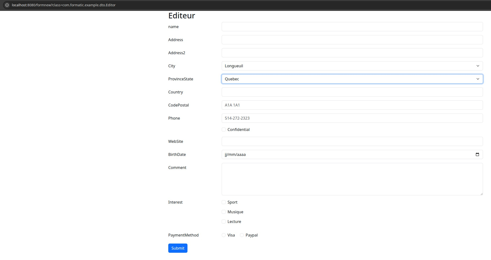
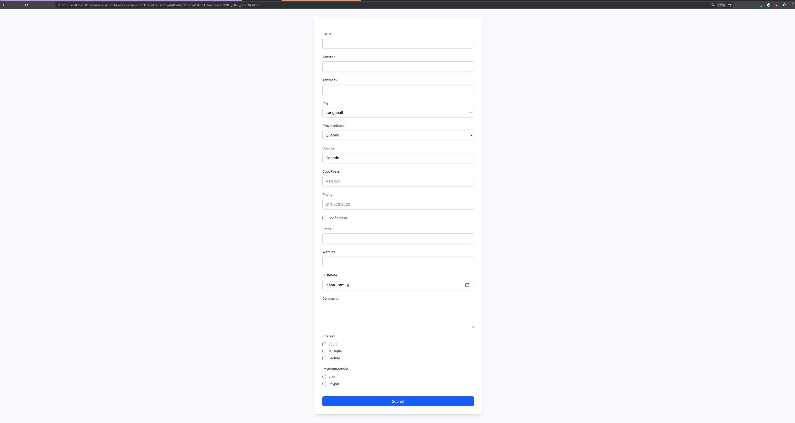

# Formatic

## Overview
Formatic is a Java library for automatic web form generation based on annotations. It enables the creation of dynamic HTML forms by simply annotating Java class fields, eliminating the need to manually write HTML code. Actually thymeleaf template engine is used. Other can be added.

## Modular Architecture
### 🎯 formatic-core - Core Module

Role: Library core, independent of any web framework
Responsibilities:

Form annotation definitions (@TextInput, @FormInput)  
Field metadata management (FormFieldMetadata)  
Annotation processing handlers (FormFieldAnnotationHandler)  
Metadata builder (FormFieldMetadataBuilder)  
Caching system for performance optimization


### 🔧 formatic-spring - Spring Integration Module

Role: Integration with Spring Boot ecosystem
Responsibilities:

Spring Boot auto-configuration (FormaticSpringAutoConfiguration)  
Automatic bean registration (handlers, builders)  
Thymeleaf templates for form rendering with boostrap, tailwind css
Automatic component scanning


### 🎨 formatic-example - Demo Module

Role: Usage examples and capability demonstration
Responsibilities:

Spring MVC controller (FormaticController)  
Example DTOs (Editor)  
Test endpoints (/form, /formhybrid, /formfeeded)
Can be used with mvc or rest application


## Design Principles
### 🎯 Separation of Concerns

Core logic independent of web frameworks  
Spring integration as separate module  
Clear boundaries between layers

### 🔧 Extensibility

Plugin-based handler system  
Easy to add new field types  
Customizable rendering templates

### ⚡ Performance

Metadata caching with ConcurrentHashMap  
Single-pass field processing   
Lazy initialization of handlers 

### 🔒 Type Safety

Annotation handlers declare their supported annotation type through `FormFieldAnnotationHandler<T extends Annotation>`.  
Form metadata uses `FormFieldType` and typed properties for input attributes.  
The annotation processor generates Java metadata classes that are checked by the compiler.  
Generated metadata does not replace validation of submitted form data.

### Use Cases

Rapid Prototyping: Quick form creation for demos  
Admin Panels: Auto-generated CRUD forms  
Dynamic Forms: Forms that change based on configuration  
Multi-tenant Applications: Different form layouts per tenant  
API Documentation: Auto-generated form examples  

This library follows the principle of "convention over configuration," making form creation as simple as adding annotations to your domain objects.

## Requirements 🔧
* Java 21 or higher.

## Using Formatic

Select a formatic annotation

- CheckboxInput  
- DateInput  
- EmailInput  
- FileInput  
- HiddenInput  
- NumberInput  
- PasswordInput  
- PhoneInput  
- RadioInput  
- SelectInput  
- TextareaInput  
- TextInput  
- UrlInput  

and attach it to a field in your class

```java
public class Editor {

    @HiddenInput
    private Long idEditeur;

    @TextInput(minLength = 2, maxLength = 20, label = "name")
    private String name;

    @TextInput
    private String address;

    @TextInput
    private String address2;

    @SelectInput(optionsProvider = "getCities", required = true)
    private String city;

    @SelectInput(optionsProvider = "getProvinces", required = true)
    private String provinceState;

    @TextInput
    private String country;

    @TextInput(pattern = "[A-Za-z][0-9][A-Za-z] [0-9][A-Za-z][0-9]", maxLength = 7, placeholder = "A1A 1A1", title = "Enter a valid Canadian postal code (e.g., A1A 1A1)")
    private String codePostal;

    @PhoneInput(pattern = "[0-9]{3}-[0-9]{3}-[0-9]{4}", placeholder = "514-272-2323")
    private String phone;

    @CheckboxInput
    private boolean confidential;

    @EmailInput
    private String email;

    @UrlInput
    private String webSite;

    @DateInput
    private LocalDate birthDate;

    @TextareaInput(rows = 5, cols = 50, required = true)
    private String comment;

    @CheckboxInput(options = {"sportCheck:Sport", "musiqueCheck:Musique", "lectureCheck:Lecture"})
    private List<String> interest;

    @RadioInput(options = {"visa:Visa", "paypal:Paypal"})
    private String paymentMethod;
}
```

Thymeleaf template use actually boostrap and tailwind css library. Bootstrap have vertical and horizontal form. Tailwind have vertical form.

Result of processing Editeur class with boostrap horizontal form parameter




Result of processing Editeur class with tailwind vertical form



### Testing the example application

From the project root, start the example application:

```bash
./gradlew :formatic-example:bootRun
```

Open `http://localhost:8080/form` with the following query parameters. Enum values are case-sensitive.

| Parameter | Values | Default |
|---|---|---|
| `class` | Fully qualified name of an annotated DTO, such as `com.formatic.example.dto.Editor` | Required |
| `cssLibrary` | `BOOTSTRAP` or `TAILWIND` | Required |
| `form` | `VERTICAL` or `HORIZONTAL` | `VERTICAL` |
| `mode` | `BYTECODE`, `REFLECTION`, or `COMPILE_TIME_GENERATION` | `BYTECODE` |

The example module includes these DTOs. Use their fully qualified name as the `class` parameter:

| DTO | `class` value |
|---|---|
| `Editor` | `com.formatic.example.dto.Editor` |
| `User` | `com.formatic.example.dto.User` |
| `UserBasic` | `com.formatic.example.dto.UserBasic` |
| `UserClub` | `com.formatic.example.dto.UserClub` |

Bootstrap supports both layouts. Tailwind supports only `VERTICAL`; do not combine `TAILWIND` with `HORIZONTAL`.
The builder query parameter is named `mode`, not `builderMode`.

Bootstrap horizontal form using the default bytecode builder:

```text
http://localhost:8080/form?class=com.formatic.example.dto.Editor&cssLibrary=BOOTSTRAP&form=HORIZONTAL
```

Bootstrap vertical form using reflection:

```text
http://localhost:8080/form?class=com.formatic.example.dto.Editor&cssLibrary=BOOTSTRAP&form=VERTICAL&mode=REFLECTION
```

Tailwind vertical form using compile-time generated metadata:

```text
http://localhost:8080/form?class=com.formatic.example.dto.Editor&cssLibrary=TAILWIND&form=VERTICAL&mode=COMPILE_TIME_GENERATION
```

To compare builders, keep `class`, `cssLibrary`, and `form` unchanged and vary only `mode`.
Compile-time mode requires generated metadata for the DTO. The example module configures the annotation processor;
running it through Gradle generates the metadata during compilation.

### DataSource for RadioInput, CheckBoxInput and SelectInput

Static or dynamic source can be provided, in the example both way are shown.  
Dynamic source search in the classpath the method name provided.

#### Dynamic 

Method name to call must be specified in the optionsProvider attribute

```java
    @SelectInput(optionsProvider = "getCities", required = true)
    private String city;
```

#### Static

Values must be specified in the options attribute

```java
    @CheckboxInput(options = {"sportCheck:Sport", "musiqueCheck:Musique", "lectureCheck:Lecture"})
    private List<String> interest;
```


## Thank You!
Please ⭐️ this repo and share it with others

## Contributing 💡
If you want to contribute to this project and make it better with new ideas, your pull request is very welcomed.
If you find any issue just put it in the repository issue section, thank you.
