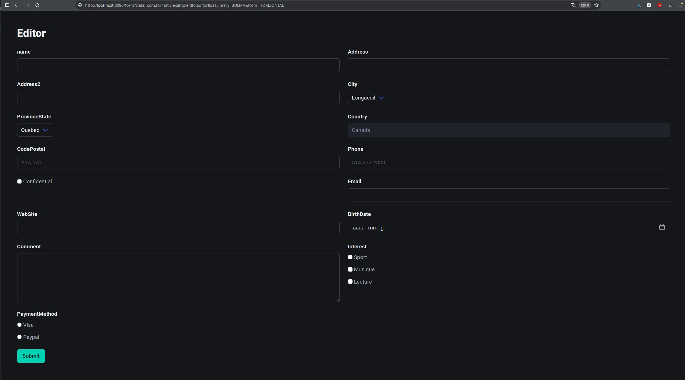

# Formatic

[](https://www.oracle.com/java/technologies/javase/jdk21-archive-downloads.html)
[](LICENSE)

**Generate responsive Thymeleaf forms from Java annotations—with Spring Boot and your choice of CSS framework.**



## ✨ Features

- Generate form fields from annotations on Java DTOs.
- Support text, date/time, range, color, choice, checkbox, file, and other common input types.
- Integrate with Spring Boot, Spring MVC, and Thymeleaf.
- Choose bundled Bootstrap, Tailwind CSS, or Bulma templates.
- Customize field metadata and override Thymeleaf templates.

## 🚀 Quick Start

Formatic requires Java 21 or higher. Clone the repository and start the example app:

```bash
git clone https://github.com/marccollin/formatic.git
cd formatic
./gradlew :formatic-example:bootRun
```

Open the example form:

```text
http://localhost:8080/form?class=com.formatic.example.dto.Editor&cssLibrary=BOOTSTRAP
```

The [Running the Example](#-running-the-example) section has more sample URLs.

## 📦 Installation

Formatic artifacts are not currently published to Maven Central or another Maven repository, so the coordinates below are not yet resolvable from a repository. Until publication, use the Gradle project dependency or composite build.

For applications in this repository's multi-project build:

```groovy
dependencies {
    implementation project(':formatic-spring')
}
```

### Modules and dependency relationships

| Module | Purpose | Dependency behavior |
|---|---|---|
| `formatic-core` | Annotations, metadata, and field builders; independent of Spring and Thymeleaf | Brings Byte Buddy as a transitive runtime dependency. Logging, validation APIs, and annotation-processing libraries are compile-time-only or processor dependencies. |
| `formatic-spring` | Spring Boot auto-configuration, Spring MVC integration, and Thymeleaf templates | Exposes `formatic-core` as an API dependency, so applications depending on this module do not also need to declare `formatic-core`. It also declares Spring Boot Web, Validation, and Thymeleaf starters as implementation dependencies. |
| `formatic-example` | Demo application and usage examples | Not required by applications using Formatic. |

With Gradle's published module metadata, `formatic-spring`'s implementation dependencies are available at runtime, but are not part of its compile-time API. Use Spring Boot's dependency management (for example, its Gradle plugin or BOM) to align Spring dependency versions. The configuration processor is a build-time annotation processor, not a runtime integration requirement.

For a separate Gradle project, add the Formatic checkout as a composite build in `settings.gradle` (adjust the path as needed):

```groovy
includeBuild('../formatic')
```

Then add the Spring module to `build.gradle` (the included build provides the unpublished artifact):

```groovy
dependencies {
    implementation 'com.formatic:formatic-spring:1.0.0'
}
```

The version above is illustrative and must match the checkout's project version.
**Maven:** Maven dependency coordinates are not available until Formatic publishes artifacts. The dependency table describes the module relationships that will be relevant to consumers after publication.

### Starting a Spring Boot application

Add `formatic-spring` as a dependency, annotate a DTO, and create your own
Spring MVC controller that builds field metadata and returns a bundled Thymeleaf
view such as `bootstrap/forms/vertical/form-base`. The library supplies
auto-configuration and templates; it does not supply a generic `/form` endpoint
or a form-submission controller. The
[new-project walkthrough](docs/USER_GUIDE.md#starting-a-new-spring-boot-project)
covers a complete GET/POST example, template selection and overrides, and
localization.

## 📖 Basic Usage

Annotate fields in a DTO to describe the form:

```java
import com.formatic.core.annotation.DateInput;
import com.formatic.core.annotation.EmailInput;
import com.formatic.core.annotation.ColorInput;
import com.formatic.core.annotation.DateTimeInput;
import com.formatic.core.annotation.TextInput;
import com.formatic.core.annotation.RangeInput;
import com.formatic.core.annotation.TimeInput;
import java.time.LocalDate;

public class ContactForm {
    @TextInput(label = "Name", required = true, maxLength = 80)
    private String name;

    @EmailInput(required = true)
    private String email;

    @DateInput
    private LocalDate preferredDate;

    @ColorInput(defaultValue = "#336699")
    private String favoriteColor;

    @ColorInput(alpha = true)
    private String overlayColor;

    @DateTimeInput(min = "2025-01-01T09:00", step = "60")
    private LocalDateTime appointment;

    @TimeInput(min = "09:00", max = "17:00", step = "300")
    private LocalTime meetingTime;

    @RangeInput(min = 0, max = 100, step = 5, defaultValue = "50")
    private int rating;
}
```

Formatic's Spring integration builds field metadata from the annotations and renders it with Thymeleaf templates. `@ColorInput` supports opaque colors by default and can enable alpha-channel editing with `alpha = true`. The HTML `datetime-local`, `time`, and `range` controls support min/max/step constraints; see the [User Guide](docs/USER_GUIDE.md) for details.

Use `@NestedForm` to include a single nested DTO with Spring-compatible names such as
`address.street`. HTML ID styles are configurable in `application.properties`;
see [nested DTOs](docs/USER_GUIDE.md#nested-dtos).

## 🎨 CSS Framework Support

| Framework | Layouts |
|---|---|
| Bootstrap | Vertical and horizontal |
| Tailwind CSS | Vertical and responsive two-column horizontal |
| Bulma | Vertical and responsive two-column horizontal |

The bundled templates render the form; include the corresponding CSS framework in your application. See [CSS and layout options](docs/USER_GUIDE.md#testing-the-example-application).

## 🔧 Advanced Topics

The [User Guide](docs/USER_GUIDE.md) covers field constraints and validation, metadata builder modes, hybrid forms, accessibility, file uploads, [dynamic options and their limits](docs/USER_GUIDE.md#dynamic-options), [internationalization](docs/USER_GUIDE.md#internationalization), [template structure and overrides](docs/USER_GUIDE.md#thymeleaf-template-structure-and-overrides), and example endpoints.

## 🧪 Running the Example

Start the demo application from the repository root:

```bash
./gradlew :formatic-example:bootRun
```

Examples:

```text
# Bootstrap vertical (default)
http://localhost:8080/form?class=com.formatic.example.dto.Editor&cssLibrary=BOOTSTRAP

# Bulma responsive two-column
http://localhost:8080/form?class=com.formatic.example.dto.Editor&cssLibrary=BULMA&form=HORIZONTAL

# Tailwind vertical
http://localhost:8080/form?class=com.formatic.example.dto.Editor&cssLibrary=TAILWIND
```

See the [example application guide](docs/USER_GUIDE.md#testing-the-example-application) for builder modes, prefilled forms, and hybrid forms.

## 🤝 Contributing

Issues and pull requests are welcome. See [Contributing](docs/USER_GUIDE.md#contributing) for contribution guidance.

## 📄 License

Formatic is licensed under the [Apache License 2.0](LICENSE).
