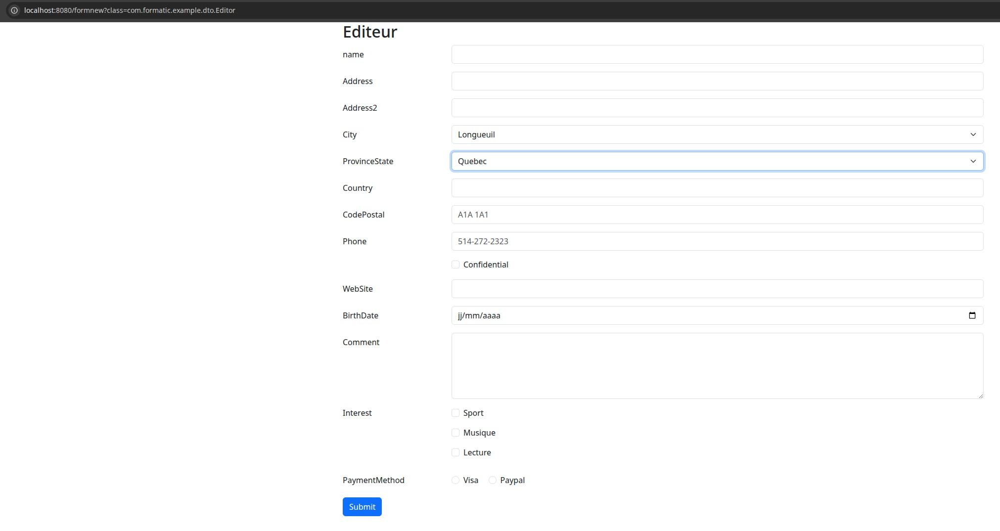
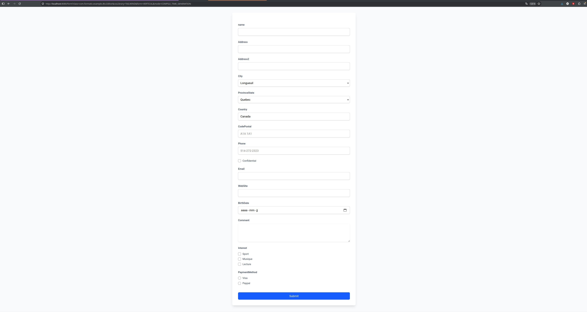

# Formatic User Guide

This guide covers Formatic's annotations, constraints, rendering options, and example application. For setup and a minimal first form, start with the [README](../README.md).

## Modular Architecture
### 🎯 formatic-core - Core Module

Role: Library core, independent of any web framework
Responsibilities:

Form annotation definitions (@TextInput, @FormInput)  
Field metadata management (FormFieldMetadata)  
Annotation processing handlers (FormFieldAnnotationHandler)  
Metadata builder (FormFieldMetadataBuilder)  
Caching system for performance optimization


### 🔧 formatic-spring - Spring Integration Module

Role: Integration with Spring Boot ecosystem
Responsibilities:

Spring Boot auto-configuration (FormaticSpringAutoConfiguration)  
Automatic bean registration (handlers, builders)  
Automatic component scanning

### formatic-spring-boot-starter-thymeleaf - Spring MVC Thymeleaf Integration

Provides the Thymeleaf templates for Bootstrap, Tailwind CSS, and Bulma and adds
Spring Boot's Thymeleaf starter. It exposes `formatic-spring` and the standalone
Thymeleaf renderer, so it is the only Formatic dependency needed for the bundled MVC forms.

### Starting a new Spring Boot project

Formatic's example application is a demo, not an endpoint provided by the
library. In your own Java 21+ Spring Boot application, add
`formatic-spring-boot-starter-thymeleaf` as an application dependency. While Formatic is unpublished, use the composite
build instructions in the [README installation section](../README.md#-installation);
after publication, use the published dependency coordinates. With a local
Formatic checkout at `../formatic`, configure a Gradle application like this:

```groovy
// settings.gradle
rootProject.name = 'contact-app'
includeBuild('../formatic')
```

```groovy
// build.gradle
plugins {
    id 'java'
    id 'org.springframework.boot' version '3.5.3'
    id 'io.spring.dependency-management' version '1.1.7'
}

java {
    toolchain {
        languageVersion = JavaLanguageVersion.of(21)
    }
}

dependencies {
    implementation 'com.formatic:formatic-spring-boot-starter-thymeleaf:1.0.0'
    implementation 'org.springframework.boot:spring-boot-starter-web'
    implementation 'org.springframework.boot:spring-boot-starter-validation'
}
```

The sample Boot version matches this repository's current build; select a
Spring Boot version compatible with your application. The composite build
substitutes the local unpublished Formatic modules for their coordinates.
Declare the Web and Validation starters directly to compile against Spring MVC
and Jakarta Validation in the controller and DTO below.

Create a DTO with Formatic field annotations and ordinary JavaBean accessors:

```java
import com.formatic.core.annotation.EmailInput;
import com.formatic.core.annotation.TextInput;
import jakarta.validation.constraints.NotBlank;

public class ContactForm {
    @TextInput(label = "Name", required = true)
    @NotBlank
    private String name;

    @EmailInput(required = true)
    private String email;

    public String getName() { return name; }
    public void setName(String name) { this.name = name; }
    public String getEmail() { return email; }
    public void setEmail(String email) { this.email = email; }
}
```

Formatic's Spring auto-configuration supplies the metadata builders and input
handlers. Add your own controller to choose the DTO, view and submission
behavior:

```java
import com.formatic.core.builder.BytecodeFormFieldMetadataBuilder;
import jakarta.validation.Valid;
import org.springframework.stereotype.Controller;
import org.springframework.ui.Model;
import org.springframework.validation.BindingResult;
import org.springframework.web.bind.annotation.GetMapping;
import org.springframework.web.bind.annotation.ModelAttribute;
import org.springframework.web.bind.annotation.PostMapping;

@Controller
public class ContactController {
    private final BytecodeFormFieldMetadataBuilder metadataBuilder;

    public ContactController(BytecodeFormFieldMetadataBuilder metadataBuilder) {
        this.metadataBuilder = metadataBuilder;
    }

    @GetMapping("/contact")
    public String show(Model model) {
        model.addAttribute("fields", metadataBuilder.buildMetadata(ContactForm.class));
        model.addAttribute("formData", new ContactForm());
        model.addAttribute("formName", "Contact");
        return "bootstrap/forms/vertical/form-base";
    }

    @PostMapping("/contact")
    public String submit(@Valid @ModelAttribute("formData") ContactForm form,
                         BindingResult result, Model model) {
        model.addAttribute("fields", metadataBuilder.buildMetadata(ContactForm.class));
        model.addAttribute("formName", "Contact");
        if (!result.hasErrors()) {
            model.addAttribute("formSuccess", "Contact details received.");
        }
        return "bootstrap/forms/vertical/form-base";
    }
}
```

The bundled form views expect `fields` and `formData`; `formName` and
`formSuccess` supply the optional heading and success message. Keep
`BindingResult` immediately after the validated model attribute and return the
same view on errors so Thymeleaf can render the field errors. The example uses
the default bytecode builder; you can inject `ReflectionFormFieldMetadataBuilder`
instead if that suits your application. Change the returned view to
`bootstrap/forms/horizontal/form-base`, `tailwind/forms/vertical/form-base`,
`tailwind/forms/horizontal/form-base`, or a Bulma view to select another bundled
layout. The library does not create your routes, persist submissions, or decide
what a successful POST should do.

Start your Spring Boot application and open `/contact`. For CSS frameworks not
included by a full-page bundled view, include the framework's assets in your
application layout. The [template guide](#thymeleaf-template-structure-and-overrides)
explains how to replace a bundled template or build your own view from the field
fragments.


### 🎨 formatic-example - Demo Module

Role: Usage examples and capability demonstration
Responsibilities:

Spring MVC controller (FormaticController)  
Example DTOs (Editor)  
Test endpoints (/form, /formhybrid, /formfeeded)
Can be used with mvc or rest application

### Using `outerCssClass` for field layout

`outerCssClass` lets an annotation add CSS classes to the field's outer wrapper.
Use it for layout classes such as Bootstrap grid columns; it does not set the
input element's class (use `cssClass` for that). For example:

The example `User` DTO already demonstrates this with Bootstrap grid classes:
`firstName` and `lastName` each use `col-md-6`, `address` uses `col-md-12`,
and `birthDate` uses `col-md-4`.

In the bundled Bootstrap vertical field templates, the supplied classes are
placed on the wrapper inside the form's Bootstrap `.row`, so the two name fields
share a row at medium and larger breakpoints, the address spans the row, and
the birth date field uses one third of it. The example app has a dedicated
`UserFormController` for this DTO:

```text
http://localhost:8080/user-form
```

`outerCssClass` values are CSS-framework-specific, not interpreted or validated
by Formatic. The bundled templates do not all apply this value the same way:
Bootstrap vertical applies it to field wrappers, while other layouts or field
types may ignore it or provide different wrapper behavior. Check the template
you use, or override it as described in
[Thymeleaf template structure and overrides](#thymeleaf-template-structure-and-overrides).


## Design Principles
### 🎯 Separation of Concerns

Core logic independent of web frameworks  
Spring integration as separate module  
Clear boundaries between layers

### 🔧 Extensibility

Plugin-based handler system  
Easy to add new field types  
Customizable rendering templates

### ⚡ Performance

Metadata caching with ConcurrentHashMap  
Single-pass field processing   
Lazy initialization of handlers 

### 🔒 Type Safety

Annotation handlers declare their supported annotation type through `FormFieldAnnotationHandler<T extends Annotation>`.  
Form metadata uses `FormFieldType` and typed properties for input attributes.  
The annotation processor generates Java metadata classes that are checked by the compiler.  
Generated metadata does not replace validation of submitted form data.

### Use Cases

Rapid Prototyping: Quick form creation for demos  
Admin Panels: Auto-generated CRUD forms  
Dynamic Forms: Forms that change based on configuration  
Multi-tenant Applications: Different form layouts per tenant  
API Documentation: Auto-generated form examples  

This library follows the principle of "convention over configuration," making form creation as simple as adding annotations to your domain objects.

## Requirements 🔧
* Java 21 or higher.

## Using Formatic

Select a formatic annotation

- CheckboxInput  
- ColorInput
- DateTimeInput
- DateInput  
- EmailInput  
- FileInput  
- HiddenInput  
- NumberInput  
- PasswordInput  
- PhoneInput  
- RadioInput  
- RangeInput
- SelectInput  
- TimeInput
- TextareaInput  
- TextInput  
- UrlInput  

and attach it to a field in your class

```java
public class Editor {

    @HiddenInput
    private Long idEditeur;

    @TextInput(minLength = 2, maxLength = 20, label = "name")
    private String name;

    @TextInput
    private String address;

    @TextInput
    private String address2;

    @SelectInput(optionsProvider = "getCities", required = true)
    private String city;

    @SelectInput(optionsProvider = "getProvinces", required = true)
    private String provinceState;

    @TextInput
    private String country;

    @TextInput(pattern = "[A-Za-z][0-9][A-Za-z] [0-9][A-Za-z][0-9]", maxLength = 7, placeholder = "A1A 1A1", title = "Enter a valid Canadian postal code (e.g., A1A 1A1)")
    private String codePostal;

    @PhoneInput(pattern = "[0-9]{3}-[0-9]{3}-[0-9]{4}", placeholder = "514-272-2323")
    private String phone;

    @CheckboxInput
    private boolean confidential;

    @EmailInput
    private String email;

    @UrlInput
    private String webSite;

    @DateInput
    private LocalDate birthDate;

    @DateTimeInput(min = "2025-01-01T09:00", max = "2025-12-31T17:00", step = "60")
    private LocalDateTime appointment;

    @TimeInput(min = "09:00", max = "17:00", step = "300")
    private LocalTime meetingTime;

    @RangeInput(min = 0, max = 100, step = 5, defaultValue = "50")
    private int rating;

    @ColorInput(defaultValue = "#336699")
    private String favoriteColor;

    @ColorInput(alpha = true, defaultValue = "#336699cc")
    private String overlayColor;

    @TextareaInput(rows = 5, cols = 50, required = true)
    private String comment;

    @CheckboxInput(options = {"sportCheck:Sport", "musiqueCheck:Musique", "lectureCheck:Lecture"})
    private List<String> interest;

    @RadioInput(options = {"visa:Visa", "paypal:Paypal"})
    private String paymentMethod;
}
```

Thymeleaf templates support Bootstrap and Tailwind CSS in vertical and responsive two-column horizontal layouts, and Bulma in vertical and responsive two-column horizontal layouts. `@ColorInput` renders as a native HTML color control in every layout. Set `alpha = true` to emit the HTML `alpha` attribute for browsers that support selecting transparency; browser support varies, and older browsers may show only an opaque picker.

Result of processing Editeur class with boostrap horizontal form parameter




Result of processing Editeur class with tailwind vertical form



### Text length constraints

Text, email, password, phone, URL, and textarea templates omit `maxlength` when
`maxLength` is negative. The annotation default is `-1`, meaning no explicit limit;
other negative annotation values are rejected during metadata validation.
Non-negative limits, including `0` and `Integer.MAX_VALUE`, are rendered unchanged
in all bundled layouts. For example, `@TextInput(maxLength = 100)` renders
`maxlength="100"`. Enforce required length limits on the server as well.

### Numeric input constraints

`@NumberInput(min = -10.5, max = 100, step = 0.01)` and
`@RangeInput(min = 0, max = 100, step = 5)` generate numeric constraints in
Bootstrap, Tailwind, and Bulma forms, including fractional steps.
Reflection, bytecode, and compile-time metadata builders support these attributes.
The default `Double.NaN` means no explicit constraint. Explicit numeric limits must
be finite, and the step must be finite and positive. Without an explicit step, the
browser uses its default step of `1`. For range controls, the browser provides
default bounds when min or max is omitted.

### Form constraint configuration

Formatic validates the annotation constraints when it builds metadata. Invalid
configuration fails with a `ConstraintValidationException` naming the DTO, field,
attribute, and value; the annotation processor reports an error on the field at
compile time. This is a compatibility change: annotations with previously ignored
invalid constraints must be corrected.

- Length limits use `-1` for unspecified; other values must be non-negative, and
  `minLength` must not exceed `maxLength`.
- Numeric bounds use `Double.NaN` for unspecified; other bounds must be finite,
  `min` must not exceed `max`, and an explicit step must be finite and positive.
- Date bounds are empty or valid HTML dates such as `2024-02-29`, with `min` no
  later than `max`. Date step is empty, `"any"`, or a finite positive HTML number
  representing days (for example `"7"` or `"0.5"`).
- `@DateTimeInput` bounds are empty or valid local date-times such as
  `"2025-03-08T10:30"` and must be ordered. `@TimeInput` bounds are empty or
  valid local times such as `"09:00"` or `"09:00:30"`; a min later than max is
  allowed to express a time range that crosses midnight. For both annotations,
  step is empty, `"any"`, or a finite positive number of seconds.

For example:

```java
public class RegistrationForm {
    @TextInput(minLength = 2, maxLength = 50)
    private String name;

    @NumberInput(min = 0, max = 100, step = 0.5)
    private double score;

    @DateInput(min = "2000-01-01", max = "2100-12-31", step = "1")
    private LocalDate registrationDate;
}
```

For comparison, `@NumberInput(step = 0)` is invalid. With the annotation processor
enabled, compilation reports the field and the invalid `step`; otherwise, a runtime
metadata builder throws `ConstraintValidationException`.

The example's `FormaticController` handles this configuration error for `/form`,
`/formfeeded`, and `/formhybrid/{id}`: it logs the detailed exception on the
server and returns HTTP 500 with a generic message, without exposing DTO names
or constraint values to clients. A consuming Spring MVC controller can use a
similar handler:

```java
@ExceptionHandler(ConstraintValidationException.class)
public ResponseEntity<String> handleInvalidFormConfiguration(ConstraintValidationException exception) {
    logger.error("Invalid form constraint configuration", exception);
    return ResponseEntity.status(HttpStatus.INTERNAL_SERVER_ERROR)
            .body("Unable to generate the form because its configuration is invalid.");
}
```

An annotation processor error stops compilation before the application starts,
so correct the annotation based on the compiler diagnostic; the runtime exception
handler cannot handle that case.

Configuration validation is separate from validation of submitted values.
Applications must still validate submissions on the server. Directly constructed
or subsequently modified `FormFieldMetadata` is not automatically revalidated;
call `FormConstraintValidator.validate(metadata, location)` when needed.

### File uploads

The bundled Bootstrap, Tailwind, and Bulma forms render `FILE` metadata as file inputs and
use `multipart/form-data` encoding when the form contains a file field.
`@FileInput(accept = "image/png,image/jpeg", multiple = true)` controls the file
picker's accepted formats and multiple-file selection.

In a Spring MVC DTO, use `MultipartFile` for a single upload and
`List<MultipartFile>` for multiple uploads. The consuming application must provide
the POST handler and validate upload size and content on the server; `accept` is
only a browser hint. File inputs cannot be prefilled from DTO values or REST data.

### Simple checkbox binding

The bundled templates use Spring-aware Thymeleaf binding for simple checkboxes.
Checked `boolean` and `Boolean` fields submit `true`; unchecked fields bind to `false`
using Spring's hidden field marker. Disabled simple checkboxes emit neither a submitted
value nor a reset marker, so an existing bound value is not reset.

Simple `String` checkboxes submit `"true"` when checked and bind to `null` when unchecked.
Prefer `boolean` or `Boolean` for true/false properties. Collection checkboxes continue
to submit their individual option values.

The hybrid form normalizes REST checkbox values to strings before matching them to
HTML input values, supporting both JSON booleans and arrays of selected options.
Its JavaScript regression tests require Node.js and can be run from the project root:

```bash
node --test formatic-spring-boot-starter-thymeleaf/src/test/javascript/hybrid-checkbox.test.cjs
```

### Disabled fields and options

In all bundled Bootstrap, Tailwind, and Bulma layouts, `disabled = true` disables the
entire checkbox group, radio group, or select. An individual option's `disabled`
flag still applies when its field is enabled; enabling an option never overrides
a disabled field.

Disabled checkbox fields and multiple selects omit Spring's hidden reset markers.
They therefore leave existing values unchanged when binding a submission onto a
preloaded DTO. Enabled collection controls retain their markers so an empty
selection can clear the collection.

Browsers do not submit disabled controls or disabled selected options. Disabling
only an option does not guarantee that its existing value will be retained when
other choices are submitted. Disabled state is a UI feature, not authorization:
the consuming application must enforce allowed updates on the server.

### Nested DTOs

Mark a single nested DTO field with `@NestedForm`. Its annotated fields are
flattened into the parent form using Spring MVC dotted binding paths:

```java
import com.formatic.core.annotation.NestedForm;
import com.formatic.core.annotation.TextInput;
import jakarta.validation.Valid;

public class CustomerForm {
    @TextInput
    private String name;

    @NestedForm
    @Valid
    private Address address = new Address();

    // Public getters and setters for both properties.
}

public class Address {
    @TextInput(label = "Street")
    private String street;

    @TextInput(label = "City")
    private String city;

    // Public getters and setters for both properties.
}
```

Metadata names and submitted input names are `name`, `address.street`, and
`address.city`. Mark further nested properties with `@NestedForm` for paths such as
`address.location.city`. Two properties of the same DTO type are supported and
receive their own prefixes. Nested fields appear at the parent property's position,
with their declaration order preserved under the built-in handlers.

Configure only the HTML ID format in your application's `application.properties`:

```properties
formatic.nested.id-style=SNAKE_CASE
```

| Setting | Input name | HTML ID |
|---|---|---|
| `DOT` (default) | `address.street` | `address.street` |
| `CAMEL_CASE` | `address.street` | `addressStreet` |
| `SNAKE_CASE` | `address.street` | `address_street` |

Labels, checkbox/radio option IDs, help IDs, and validation error links follow the
configured ID style. Top-level IDs stay unchanged. Spring binding and error paths
always remain dotted; this setting does not rename submitted parameters. Duplicate
field names or IDs caused by the selected style fail with a configuration error.
In core-only usage, pass a `FieldIdStyle` to the builder's overloaded constructor.
Custom templates should use `field.id` for IDs and labels, `field.name` for binding
and errors, and `field.valuePath` for null-safe SpringEL value reads.

Reflection, bytecode, and compile-time builders support nested DTOs. The annotation
processor generates flattened parent metadata and uses binary names for static
inner DTO classes. Class-based metadata generation does not instantiate DTOs.
Use public bean accessors and initialize nested objects, as above, or give them a
public no-argument constructor so Spring can auto-grow nested paths during binding.
Read-only value rendering is null-safe; bound select/checkbox/radio controls may
cause Spring to initialize null nested objects.

`@NestedForm` does not enable Bean Validation by itself. Add `@Valid` on nested
properties and use `@Valid @ModelAttribute("formData")` plus `BindingResult` in the
POST handler to cascade validation. Field errors such as `address.street` render
next to the corresponding control. The hybrid template also reads nested JSON
using dotted input names.

This first version supports concrete, single-valued DTOs using declared fields.
Unmarked nested objects are ignored. Collections of DTOs, maps, arrays, optional
wrappers, records, interfaces, abstract types, and cyclic `@NestedForm` relationships
are not supported. Do not combine `@NestedForm` with an input annotation on the same
property. Keep input annotation names aligned with actual bean properties;
use the ID style setting rather than `name` overrides for cosmetic naming.

Try the example with:

```bash
./gradlew :formatic-example:bootRun
```

```text
# Bootstrap vertical
http://localhost:8080/form?class=com.formatic.example.dto.CustomerForm&cssLibrary=BOOTSTRAP&mode=REFLECTION

# Bulma responsive two-column layout
http://localhost:8080/form?class=com.formatic.example.dto.CustomerForm&cssLibrary=BULMA&form=HORIZONTAL&mode=REFLECTION
```

### Validation feedback and accessibility

The bundled templates support native browser validation, custom frontend validation,
and Spring MVC validation without requiring JavaScript or HTMX. Existing HTML
constraints (`required`, `pattern`, length and numeric limits) remain in place.
Use `novalidate` on your application's form if you want to bypass native browser
validation and rely on the backend or your own frontend validation instead.

All visible fields link help text through `aria-describedby` when help is present.
When Spring's `BindingResult` contains errors for a field, its controls receive
`aria-invalid="true"` and Bootstrap invalid styling or Tailwind red border/focus
styling, and Bulma danger styling. Escaped validation messages appear in an accessible error block; every
checkbox/radio option links to the same group feedback. Hidden inputs do not
receive visible feedback. Annotation `errorMessage` values are not automatically
shown: an error message alone does not mean validation failed.

For backend validation, use Bean Validation constraints on your DTO and
`@Valid @ModelAttribute("formData")` with an immediately following `BindingResult`
parameter in your POST handler, or populate a `BindingResult` using your own
Spring validator. On failure, return the form view with its field metadata,
the submitted DTO, and its binding result intact rather than redirecting or
replacing the DTO. Global/object errors are not displayed by individual fields;
provide an application-level summary if needed. Formatic does not perform
server-side validation merely because a Formatic annotation declares a constraint.

The IDs `<field-id>-help` and `<field-id>-errors` provide hooks for custom
frontend validation. The error block is rendered only when server field errors
exist; frontend code may create its own block using that ID and update
`aria-invalid`/`aria-describedby` as validation changes. For HTMX, return and swap
the error-aware form fragment from your application's POST handler. No
HTMX-specific library configuration is required. Backend validation remains
necessary regardless of the frontend approach.

### Thymeleaf template structure and overrides

Spring MVC templates are packaged in `formatic-spring-boot-starter-thymeleaf` under
`src/main/resources/templates/`. The relative path without `.html` is the
Thymeleaf view name; for example, returning
`bootstrap/forms/vertical/form-base` from a controller renders
`bootstrap/forms/vertical/form-base.html`:

```text
bootstrap/forms/{vertical,horizontal}/form-base.html
bootstrap/forms/{vertical,horizontal}/fields/{type}-field.html
tailwind/forms/{vertical,horizontal}/form-base.html
tailwind/forms/vertical/fields/{type}-field.html
bulma/forms/vertical/form-base.html
bulma/forms/vertical/fields/{type}-field.html
bulma/forms/horizontal/form-base.html
bootstrap/forms/form-base-hybrid.html
```

Each `form-base.html` dispatches fields by `field.type` and inserts the matching
`<type>-field` fragment. The CSS-specific field fragments live in the `fields`
directory. Tailwind horizontal and Bulma horizontal form bases reuse their
framework's vertical field fragments. The special Bootstrap
`form-base-hybrid.html` is a separate example that populates a form from a JSON
endpoint.

To replace a template, put a file at the same relative path in your application's
`src/main/resources/templates/`. For example:

```text
src/main/resources/templates/bootstrap/forms/vertical/fields/text-field.html
```

An application copy takes precedence with the default Spring Boot Thymeleaf
configuration and normal application-before-dependency classpath order. Other
templates continue to load from the library JAR. Custom resolvers or classpath
ordering may change this behavior.

There are two common ways to use the templates:

1. **Use a bundled form as-is.** Put `fields` and `formData` in the model and
   return a bundled form-base view name from your controller, as in the
   [new-project walkthrough](#starting-a-new-spring-boot-project).
2. **Customize the bundled form.** Copy the desired `form-base.html` into your
   application's templates at the same path and edit it. You can also override
   only a field fragment; all other fragments continue to come from the library.

To create a separate custom view, place it at a new path such as
`src/main/resources/templates/contact/form.html` and return `contact/form` from
your controller. Copy a bundled form base to preserve its field-type dispatch,
or call the bundled field fragments from your own `th:each`/`th:switch`; for
example:

```html
<div th:each="field : ${fields}" th:switch="${field.type.name()}">
    <div th:case="'TEXT'"
         th:replace="~{bootstrap/forms/vertical/fields/text-field :: text-field(${field})}"></div>
    <!-- Add the other field types used by your DTO, following the bundled form base. -->
</div>
```

Your custom view must still receive `fields` and `formData`. If you do not use
the bundled form base, your page is also responsible for including the CSS
framework assets and any form-level behaviors it needs.

You can replace an entire form base or an individual field fragment. When
replacing a field fragment, keep its fragment name and parameter, such as
`th:fragment="text-field(field)"`, because the form base includes it by that
signature. For a form base, retain the `Generic` fragment and the model contract
used by your view (`fields` and `formData`; some bundled templates additionally
render `formName` and `formSuccess`). Preserve field binding names, IDs, error display,
and accessibility attributes if you rely on those behaviors. Copy the library
template as a starting point and change only what your application needs.

The example module's `TemplateOverrideIntegrationTest` verifies both local overrides and
library JAR fallback through a rendered Spring MVC request.

### Internationalization

Spring Boot and Thymeleaf can resolve localized messages using the application's
`MessageSource` and request locale. Add a default bundle and locale-specific
bundles to the application, for example:

```text
src/main/resources/messages.properties
src/main/resources/messages_fr.properties
```

```properties
# messages.properties
form.contact.name=Name
form.contact.email=Email
form.contact.name.required=Enter a name
```

```properties
# messages_fr.properties
form.contact.name=Nom
form.contact.email=Courriel
form.contact.name.required=Le nom est obligatoire
```

Bean Validation constraint messages can use standard message keys, for example
`@NotBlank(message = "{form.contact.name.required}")`; Spring resolves those
messages for the active locale when validation runs.

Mark a field label as a message key using `#{...}`. Ordinary labels remain
literal text:

```java
@TextInput(label = "#{form.contact.name}")
private String name;
```

For JTE, Pebble, or standalone Thymeleaf with Spring MVC,
`SpringFormRenderModels.fromBinding(...)` resolves labels automatically using
the supplied `MessageSource` and request locale. For the existing Spring MVC
Thymeleaf templates, localize the metadata before placing it in the model:

```java
model.addAttribute("fields", SpringFormFieldLabels.resolve(
        metadataBuilder.buildMetadata(Contact.class), messageSource, locale));
```

`SpringFormFieldLabels` is in `com.formatic.spring.render`; inject your
application's `MessageSource` and accept `Locale` in the controller. Repeat
the step for GET and POST, including validation failures. The helper returns
copies and never changes cached metadata, so concurrent requests can use
different locales.

Without Spring, localize before constructing `RenderField` instances:

```java
var localized = FormFieldLabels.resolveBundle(metadata, locale, "messages");
var fields = localized.stream().map(RenderField::new).toList();
String html = renderer.render(new FormRenderModel("Contact", "/contact", fields));
```

`FormFieldLabels` is in `com.formatic.core.form`; its `resolve(...)` method also
accepts a custom `(key, locale) -> Optional<String>` lookup. Resource bundles
belong in the consuming application's classpath, not the Formatic library.
When a key or bundle is missing, Formatic logs a warning and uses the
capitalized last segment of the field's binding name (for example,
`address.birthDate` becomes `BirthDate`). Malformed markers and unmarked
labels remain literal.

This feature covers annotation **labels only**. Help text, option labels,
page headings, `Submit`, and `Select…` still require application or template
customization. To translate validation errors, use Bean Validation message
keys as above. Spring Boot's
default web locale resolution uses the request locale, commonly selected by the
browser's `Accept-Language` header. You can verify a translation with a request
such as:

```bash
curl -H 'Accept-Language: fr' http://localhost:8080/contact
```

If the application needs a different locale-selection policy, configure Spring
MVC's locale resolver/interceptor and keep the message bundle names aligned with
that policy. Set `spring.messages.fallback-to-system-locale=false` when default
bundle fallback should not depend on the server's locale.

### Choosing a CSS library and layout with JTE or Pebble

Both renderers support `FormTheme.BOOTSTRAP`, `FormTheme.TAILWIND`, and
`FormTheme.BULMA`, each with `FormLayout.VERTICAL` or `FormLayout.HORIZONTAL`.
Constructors that take only a template name use Bootstrap vertical. The Bootstrap
horizontal layout puts labels beside controls on wider screens; Tailwind and
Bulma use responsive two-column field grids. For example:

```java
FormRenderer jte = new JteFormRenderer("formatic/", "form.jte",
        FormTheme.TAILWIND, FormLayout.HORIZONTAL);
FormRenderer pebble = new PebbleFormRenderer("formatic/pebble/", "form.peb",
        FormTheme.BULMA, FormLayout.HORIZONTAL);
```

`FormTheme` and `FormLayout` are in `com.formatic.render`. Load the chosen CSS
library in the containing page. For production Tailwind builds, include
Formatic's shared class definitions in your source scan:
[`FormStyle.java`](../formatic-render-api/src/main/java/com/formatic/render/internal/FormStyle.java).
The demos use Tailwind's browser CDN for convenience, not for production.
Use the style links on either customer demo or add, for example,
`?theme=TAILWIND&layout=HORIZONTAL` to its URL.

### Rendering with JTE

`formatic-render-jte` renders forms as HTML fragments.
It supports the existing field types, nested binding names, and validation
feedback. Its templates are compiled during the library build; applications
using the bundled renderer do not need the JTE Gradle plugin or a template
compiler at runtime. Existing Thymeleaf views and overrides work as before.

In the local composite build described above, use:

```groovy
dependencies {
    implementation 'com.formatic:formatic-render-jte:1.0.0'
    // Add this only if you use the Spring Boot builders or MVC binding adapter:
    implementation 'com.formatic:formatic-spring:1.0.0'
}
```

In a plain Java application, pass core metadata and optional request values to
the renderer directly:

```java
FormRenderer renderer = new JteFormRenderer("formatic/form.jte");
String html = renderer.render(new FormRenderModel("Contact", "/contact",
        metadata.stream().map(RenderField::new).toList()));
```

`FormRenderer`, `FormRenderModel`, and `RenderField` are in `com.formatic.render`;
`JteFormRenderer` is in `com.formatic.render.jte`. Pass a root-relative submission
path (including the context path, if any), or an empty string to submit to the
current URL.

For Spring MVC, call `SpringFormRenderModels.fromBinding(...)` with the form
metadata, `BindingResult`, `MessageSource`, and request locale. The adapter keeps
dotted field names and resolved validation errors, including errors on nested
DTOs. Pass the resulting model to a [named MVC view](#using-jte-or-pebble-as-spring-mvc-views),
or render it directly as HTML. For CSRF-protected applications, supply the
framework's token name and value through the model's `hiddenFields` map; the
renderer does not look up request attributes or add security tokens on its own.

Run `./gradlew :formatic-example:bootRun` and open
`http://localhost:8080/jte/customer`. Submit an empty street to see a nested
validation error. If your browser blocks empty fields, remove the HTML `required`
attribute for that test or POST directly. The demo does not save submissions.

### Rendering with Pebble

`formatic-render-pebble` renders forms as HTML fragments.
It loads the bundled `.peb` templates from the classpath and does not require
Spring, a Pebble starter, or a build plugin.

With the local composite build, add:

```groovy
dependencies {
    implementation 'com.formatic:formatic-render-pebble:1.0.0'
}
```

Use the same rendering model as JTE, with
`com.formatic.render.pebble.PebbleFormRenderer`:

```java
FormRenderer renderer = new PebbleFormRenderer("formatic/pebble/form.peb");
String html = renderer.render(new FormRenderModel("Contact", "/contact",
        metadata.stream().map(RenderField::new).toList()));
```

Your application handles the submission. Pass submitted values and validation
errors in `RenderField`, or, in Spring MVC, add `formatic-spring` and use the
same `SpringFormRenderModels.fromBinding(...)` adapter described above. Use a
root-relative action (including any context path) or an empty string. Supply
any CSRF token through `hiddenFields` when required.

Run `./gradlew :formatic-example:bootRun` and open
`http://localhost:8080/pebble/customer` to try nested DTO binding and validation.

### Choosing your own JTE or Pebble template

Every renderer needs an explicit template name. The bundled templates are still
available at the names shown above, but neither renderer selects one automatically
or falls back to one if your selection is missing.

| Engine | Example file in your project | Template name from the loader root |
|---|---|---|
| JTE | `src/main/jte/myapp/forms/contact.jte` | `myapp/forms/contact.jte` |
| Pebble | `src/main/resources/templates/myapp/forms/contact.peb` | `templates/myapp/forms/contact.peb` |

Precompile your own JTE templates with the JTE Gradle or Maven plugin. Pebble
loads `.peb` files as classpath resources. Both renderers also accept an
application-provided engine if you need custom loading. Use a unique template
path rather than overriding a bundled resource by classpath order.

Custom templates receive a `form` variable of type `FormRenderModel`, including
its `RenderField` values and errors. In JTE, declare
`@param com.formatic.render.FormRenderModel form` and use `${form.title()}`;
in Pebble, use `{{ form.title() }}`. Your template controls the markup; it
doesn't need to import the internal helpers used by the bundled templates.

### Using JTE or Pebble as Spring MVC views

With `formatic-spring` and your chosen renderer on the classpath, optionally
set the template folder in `application.properties`:

```properties
formatic.jte.template-prefix=myapp/forms/
formatic.pebble.template-prefix=templates/myapp/forms/
```

The prefix is relative to JTE's compiled template root or Pebble's classpath
loader root. An unset prefix means the loader's root; there is no default
template property. Register the view by explicitly choosing its template:

```java
@Bean
FormRendererViewResolver formViews(FormaticProperties properties) {
    var renderer = new PebbleFormRenderer(properties.getPebble().getTemplatePrefix(),
            "contact.peb", FormTheme.BOOTSTRAP, FormLayout.VERTICAL);
    return new FormRendererViewResolver(Map.of("contact-form", renderer));
}
```

For JTE, use `JteFormRenderer`, `properties.getJte().getTemplatePrefix()`, and
`"contact.jte"` instead. In your MVC controller, add the `FormRenderModel` as
`form` and return the registered view name (without `@ResponseBody`):

```java
model.addAttribute(FormRendererViewResolver.FORM_MODEL_ATTRIBUTE, form);
return "contact-form";
```

The resolver serves only registered names, so it can coexist with Thymeleaf
and other MVC view resolvers. It writes the selected renderer's HTML as the
response; use a full-page template if you want to include your page layout.

### Rendering with standalone Thymeleaf

The `formatic-render-thymeleaf` module renders `FormRenderModel`
without Spring. The `formatic-spring-boot-starter-thymeleaf` module includes it,
while retaining the original Spring MVC templates and their override paths.
For a plain Java application, add only:

```groovy
implementation 'com.formatic:formatic-render-thymeleaf:1.0.0'
```

Select a template explicitly. The bundled template supports all three
`FormTheme` values and both `FormLayout` values:

```java
FormRenderer renderer = new ThymeleafFormRenderer(
        "templates/formatic/standalone/", "form.html",
        FormTheme.BOOTSTRAP, FormLayout.VERTICAL);
String html = renderer.render(new FormRenderModel("Contact", "/contact",
        metadata.stream().map(RenderField::new).toList()));
```

`ThymeleafFormRenderer` is in `com.formatic.render.thymeleaf`. For your own
template, place an HTML file in `src/main/resources` and provide its classpath
folder and filename. The standard Thymeleaf dialect receives `form` (a
`FormRenderModel`) and escapes expressions such as `th:text="${form.title()}"`.
An application-provided `ITemplateEngine` can be passed to the renderer
constructor for custom loading. Missing templates fail; there is no fallback.

For Spring MVC, set `formatic.thymeleaf.template-prefix` in
`application.properties`, register a `ThymeleafFormRenderer` with the
`FormRendererViewResolver` as shown above, and provide the form model under
`form`. The example app demonstrates this at `/thymeleaf/customer`. This
standalone template contract is separate from the existing Spring MVC
`th:field` templates; their view names and overrides continue to work.

### Testing the example application

From the project root, start the example application:

```bash
./gradlew :formatic-example:bootRun
```

Open `http://localhost:8080/form` with the following query parameters. Enum values are case-sensitive.

| Parameter | Values | Default |
|---|---|---|
| `class` | Fully qualified name of an annotated DTO, such as `com.formatic.example.dto.Editor` | Required |
| `cssLibrary` | `BOOTSTRAP`, `TAILWIND`, or `BULMA` | Required |
| `form` | `VERTICAL` or `HORIZONTAL` | `VERTICAL` |
| `mode` | `BYTECODE`, `REFLECTION`, or `COMPILE_TIME_GENERATION` | `BYTECODE` |

The example module includes these DTOs. Use their fully qualified name as the `class` parameter:

| DTO | `class` value |
|---|---|
| `Editor` | `com.formatic.example.dto.Editor` |
| `User` | `com.formatic.example.dto.User` |
| `UserBasic` | `com.formatic.example.dto.UserBasic` |
| `UserClub` | `com.formatic.example.dto.UserClub` |

Bootstrap, Tailwind, and Bulma support both layouts. The Tailwind and Bulma horizontal layouts stack fields on smaller screens and display two columns on desktop screens.
The builder query parameter is named `mode`, not `builderMode`.

Bootstrap horizontal form using the default bytecode builder:

```text
http://localhost:8080/form?class=com.formatic.example.dto.Editor&cssLibrary=BOOTSTRAP&form=HORIZONTAL
```

Bootstrap vertical form using reflection:

```text
http://localhost:8080/form?class=com.formatic.example.dto.Editor&cssLibrary=BOOTSTRAP&form=VERTICAL&mode=REFLECTION
```

Tailwind vertical form using compile-time generated metadata:

```text
http://localhost:8080/form?class=com.formatic.example.dto.Editor&cssLibrary=TAILWIND&form=VERTICAL&mode=COMPILE_TIME_GENERATION
```

Tailwind horizontal form:

```text
http://localhost:8080/form?class=com.formatic.example.dto.Editor&cssLibrary=TAILWIND&form=HORIZONTAL
```

Bulma vertical form:

```text
http://localhost:8080/form?class=com.formatic.example.dto.Editor&cssLibrary=BULMA&form=VERTICAL
```

Bulma responsive two-column form:

```text
http://localhost:8080/form?class=com.formatic.example.dto.Editor&cssLibrary=BULMA&form=HORIZONTAL
```

To compare builders, keep `class`, `cssLibrary`, and `form` unchanged and vary only `mode`.
Compile-time mode requires generated metadata for the DTO. The example module configures the annotation processor;
running it through Gradle generates the metadata during compilation.

#### Prefilled form: `/formfeeded`

```text
http://localhost:8080/formfeeded
```

Unlike `/form`, which creates a new instance of the DTO selected by `class`,
`/formfeeded` always creates an `Editor` and sets several values in the controller
before rendering, including city, postal code, birth date, interests, and payment method.
It uses the reflection builder and the Bootstrap vertical layout.
There are no `class`, `cssLibrary`, `form`, or `mode` parameters for this endpoint,
and no REST request is needed to populate its values.

Submitting this form sends `POST /formfeeded`. The example binds the submitted
`Editor` and redisplays it with a confirmation, or shows Spring binding errors
if conversion fails. This is a demo: it does not persist changes or automatically
validate submitted values against Formatic annotation constraints. Disabled fields
are not submitted by the browser, and the handler does not reload stored values.

#### Hybrid form: `/formhybrid/{id}`

```text
http://localhost:8080/formhybrid/1?class=com.formatic.example.dto.Editor
```

Unlike `/formfeeded`, the hybrid endpoint first renders a new DTO using the reflection
builder and Bootstrap horizontal fragments. Browser JavaScript then fetches
`/api/editors/{id}` and populates the fields from the JSON response.
The `class` parameter selects the initial DTO, while the path ID selects the editor data.
Use `com.formatic.example.dto.Editor` to match the editor REST response.
The endpoint does not accept layout or builder selection parameters.

Change the path ID to `2` or `3` to load another editor. JavaScript and a successful
REST response are required for the saved editor values to appear.

#### Testing the REST controller

`FormaticRestController` returns editor data as JSON:

```text
http://localhost:8080/api/editors/1
http://localhost:8080/api/editors/2
http://localhost:8080/api/editors/3
```

An unknown editor ID returns HTTP `404`.

These URLs return JSON only, not a rendered form. The hybrid page described above
consumes the same endpoint to populate its fields.

### Dynamic options

`@SelectInput`, `@RadioInput`, and option-based `@CheckboxInput` fields accept
either static options or an `optionsProvider`. Static options use
`value:label` entries:

```java
@CheckboxInput(options = {"sport:Sport", "music:Music"})
private List<String> interests;
```

A dynamic provider is a public, zero-argument method returning a `List` or
`Map` on a Spring-managed bean. For example:

```java
import com.formatic.core.form.SelectRadioOption;
import org.springframework.stereotype.Service;

import java.util.List;

@Service
public class LocationOptions {
    public List<SelectRadioOption> getCities() {
        return List.of(
            new SelectRadioOption("NYC", "New York"),
            new SelectRadioOption("YUL", "Montreal")
        );
    }
}
```

Reference the method by name from the DTO:

```java
@SelectInput(optionsProvider = "getCities", required = true)
private String city;
```

Formatic discovers provider methods from Spring beans, converts the result to
`SelectRadioOption` values, and caches it by provider method name. The provider
does not receive the current form, request, or another field's value. Provider
results are resolved when metadata is built, not once per HTTP request. The
metadata builders also cache results per DTO class, so clearing the option
service's cache alone does not refresh metadata that a builder has already
cached. Treat these providers as fixed metadata-time options; use an
application-specific request handler or custom metadata strategy when options
must change per request.

This provider mechanism supplies options when Formatic builds field metadata;
it is not a built-in cascading-dropdown or conditional-display system. For
cascading choices, expose an application endpoint that accepts the parent value
and use JavaScript or HTMX to fetch and replace the dependent options. For
conditional field visibility, use application JavaScript/HTMX or a custom
Thymeleaf template. In both cases, validate submitted values on the server;
client-side visibility or option filtering is not an authorization or validation
boundary.
