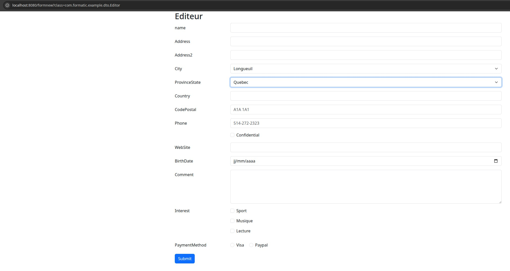
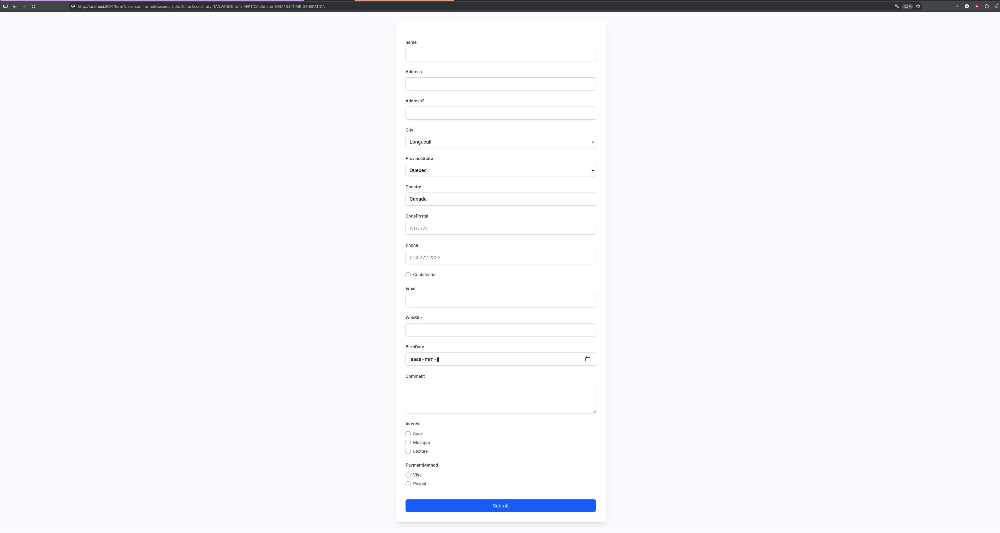

# Formatic User Guide

This guide covers Formatic's annotations, constraints, rendering options, and example application. For setup and a minimal first form, start with the [README](../README.md).

## Modular Architecture
### 🎯 formatic-core - Core Module

Role: Library core, independent of any web framework
Responsibilities:

Form annotation definitions (@TextInput, @FormInput)  
Field metadata management (FormFieldMetadata)  
Annotation processing handlers (FormFieldAnnotationHandler)  
Metadata builder (FormFieldMetadataBuilder)  
Caching system for performance optimization


### 🔧 formatic-spring - Spring Integration Module

Role: Integration with Spring Boot ecosystem
Responsibilities:

Spring Boot auto-configuration (FormaticSpringAutoConfiguration)  
Automatic bean registration (handlers, builders)  
Thymeleaf templates for form rendering with Bootstrap, Tailwind CSS, and Bulma
Automatic component scanning


### 🎨 formatic-example - Demo Module

Role: Usage examples and capability demonstration
Responsibilities:

Spring MVC controller (FormaticController)  
Example DTOs (Editor)  
Test endpoints (/form, /formhybrid, /formfeeded)
Can be used with mvc or rest application


## Design Principles
### 🎯 Separation of Concerns

Core logic independent of web frameworks  
Spring integration as separate module  
Clear boundaries between layers

### 🔧 Extensibility

Plugin-based handler system  
Easy to add new field types  
Customizable rendering templates

### ⚡ Performance

Metadata caching with ConcurrentHashMap  
Single-pass field processing   
Lazy initialization of handlers 

### 🔒 Type Safety

Annotation handlers declare their supported annotation type through `FormFieldAnnotationHandler<T extends Annotation>`.  
Form metadata uses `FormFieldType` and typed properties for input attributes.  
The annotation processor generates Java metadata classes that are checked by the compiler.  
Generated metadata does not replace validation of submitted form data.

### Use Cases

Rapid Prototyping: Quick form creation for demos  
Admin Panels: Auto-generated CRUD forms  
Dynamic Forms: Forms that change based on configuration  
Multi-tenant Applications: Different form layouts per tenant  
API Documentation: Auto-generated form examples  

This library follows the principle of "convention over configuration," making form creation as simple as adding annotations to your domain objects.

## Requirements 🔧
* Java 21 or higher.

## Using Formatic

Select a formatic annotation

- CheckboxInput  
- DateInput  
- EmailInput  
- FileInput  
- HiddenInput  
- NumberInput  
- PasswordInput  
- PhoneInput  
- RadioInput  
- SelectInput  
- TextareaInput  
- TextInput  
- UrlInput  

and attach it to a field in your class

```java
public class Editor {

    @HiddenInput
    private Long idEditeur;

    @TextInput(minLength = 2, maxLength = 20, label = "name")
    private String name;

    @TextInput
    private String address;

    @TextInput
    private String address2;

    @SelectInput(optionsProvider = "getCities", required = true)
    private String city;

    @SelectInput(optionsProvider = "getProvinces", required = true)
    private String provinceState;

    @TextInput
    private String country;

    @TextInput(pattern = "[A-Za-z][0-9][A-Za-z] [0-9][A-Za-z][0-9]", maxLength = 7, placeholder = "A1A 1A1", title = "Enter a valid Canadian postal code (e.g., A1A 1A1)")
    private String codePostal;

    @PhoneInput(pattern = "[0-9]{3}-[0-9]{3}-[0-9]{4}", placeholder = "514-272-2323")
    private String phone;

    @CheckboxInput
    private boolean confidential;

    @EmailInput
    private String email;

    @UrlInput
    private String webSite;

    @DateInput
    private LocalDate birthDate;

    @TextareaInput(rows = 5, cols = 50, required = true)
    private String comment;

    @CheckboxInput(options = {"sportCheck:Sport", "musiqueCheck:Musique", "lectureCheck:Lecture"})
    private List<String> interest;

    @RadioInput(options = {"visa:Visa", "paypal:Paypal"})
    private String paymentMethod;
}
```

Thymeleaf templates support Bootstrap in vertical and horizontal layouts, Tailwind CSS in vertical layouts, and Bulma in vertical and responsive two-column horizontal layouts.

Result of processing Editeur class with boostrap horizontal form parameter




Result of processing Editeur class with tailwind vertical form



### Text length constraints

Text, email, password, phone, URL, and textarea templates omit `maxlength` when
`maxLength` is negative. The annotation default is `-1`, meaning no explicit limit;
other negative annotation values are rejected during metadata validation.
Non-negative limits, including `0` and `Integer.MAX_VALUE`, are rendered unchanged
in all bundled layouts. For example, `@TextInput(maxLength = 100)` renders
`maxlength="100"`. Enforce required length limits on the server as well.

### Numeric input constraints

`@NumberInput(min = -10.5, max = 100, step = 0.01)` generates numeric constraints
in Bootstrap, Tailwind, and Bulma forms, including fractional steps.
Reflection, bytecode, and compile-time metadata builders support these attributes.
The default `Double.NaN` means no explicit constraint. Explicit numeric limits must
be finite, and the step must be finite and positive. Without an explicit step, the
browser uses its default step of `1`.

### Form constraint configuration

Formatic validates the annotation constraints when it builds metadata. Invalid
configuration fails with a `ConstraintValidationException` naming the DTO, field,
attribute, and value; the annotation processor reports an error on the field at
compile time. This is a compatibility change: annotations with previously ignored
invalid constraints must be corrected.

- Length limits use `-1` for unspecified; other values must be non-negative, and
  `minLength` must not exceed `maxLength`.
- Numeric bounds use `Double.NaN` for unspecified; other bounds must be finite,
  `min` must not exceed `max`, and an explicit step must be finite and positive.
- Date bounds are empty or valid HTML dates such as `2024-02-29`, with `min` no
  later than `max`. Date step is empty, `"any"`, or a finite positive HTML number
  representing days (for example `"7"` or `"0.5"`).

For example:

```java
public class RegistrationForm {
    @TextInput(minLength = 2, maxLength = 50)
    private String name;

    @NumberInput(min = 0, max = 100, step = 0.5)
    private double score;

    @DateInput(min = "2000-01-01", max = "2100-12-31", step = "1")
    private LocalDate registrationDate;
}
```

For comparison, `@NumberInput(step = 0)` is invalid. With the annotation processor
enabled, compilation reports the field and the invalid `step`; otherwise, a runtime
metadata builder throws `ConstraintValidationException`.

The example's `FormaticController` handles this configuration error for `/form`,
`/formfeeded`, and `/formhybrid/{id}`: it logs the detailed exception on the
server and returns HTTP 500 with a generic message, without exposing DTO names
or constraint values to clients. A consuming Spring MVC controller can use a
similar handler:

```java
@ExceptionHandler(ConstraintValidationException.class)
public ResponseEntity<String> handleInvalidFormConfiguration(ConstraintValidationException exception) {
    logger.error("Invalid form constraint configuration", exception);
    return ResponseEntity.status(HttpStatus.INTERNAL_SERVER_ERROR)
            .body("Unable to generate the form because its configuration is invalid.");
}
```

An annotation processor error stops compilation before the application starts,
so correct the annotation based on the compiler diagnostic; the runtime exception
handler cannot handle that case.

Configuration validation is separate from validation of submitted values.
Applications must still validate submissions on the server. Directly constructed
or subsequently modified `FormFieldMetadata` is not automatically revalidated;
call `FormConstraintValidator.validate(metadata, location)` when needed.

### File uploads

The bundled Bootstrap, Tailwind, and Bulma forms render `FILE` metadata as file inputs and
use `multipart/form-data` encoding when the form contains a file field.
`@FileInput(accept = "image/png,image/jpeg", multiple = true)` controls the file
picker's accepted formats and multiple-file selection.

In a Spring MVC DTO, use `MultipartFile` for a single upload and
`List<MultipartFile>` for multiple uploads. The consuming application must provide
the POST handler and validate upload size and content on the server; `accept` is
only a browser hint. File inputs cannot be prefilled from DTO values or REST data.

### Simple checkbox binding

The bundled templates use Spring-aware Thymeleaf binding for simple checkboxes.
Checked `boolean` and `Boolean` fields submit `true`; unchecked fields bind to `false`
using Spring's hidden field marker. Disabled simple checkboxes emit neither a submitted
value nor a reset marker, so an existing bound value is not reset.

Simple `String` checkboxes submit `"true"` when checked and bind to `null` when unchecked.
Prefer `boolean` or `Boolean` for true/false properties. Collection checkboxes continue
to submit their individual option values.

The hybrid form normalizes REST checkbox values to strings before matching them to
HTML input values, supporting both JSON booleans and arrays of selected options.
Its JavaScript regression tests require Node.js and can be run from the project root:

```bash
node --test formatic-spring/src/test/javascript/hybrid-checkbox.test.cjs
```

### Disabled fields and options

In all bundled Bootstrap, Tailwind, and Bulma layouts, `disabled = true` disables the
entire checkbox group, radio group, or select. An individual option's `disabled`
flag still applies when its field is enabled; enabling an option never overrides
a disabled field.

Disabled checkbox fields and multiple selects omit Spring's hidden reset markers.
They therefore leave existing values unchanged when binding a submission onto a
preloaded DTO. Enabled collection controls retain their markers so an empty
selection can clear the collection.

Browsers do not submit disabled controls or disabled selected options. Disabling
only an option does not guarantee that its existing value will be retained when
other choices are submitted. Disabled state is a UI feature, not authorization:
the consuming application must enforce allowed updates on the server.

### Validation feedback and accessibility

The bundled templates support native browser validation, custom frontend validation,
and Spring MVC validation without requiring JavaScript or HTMX. Existing HTML
constraints (`required`, `pattern`, length and numeric limits) remain in place.
Use `novalidate` on your application's form if you want to bypass native browser
validation and rely on the backend or your own frontend validation instead.

All visible fields link help text through `aria-describedby` when help is present.
When Spring's `BindingResult` contains errors for a field, its controls receive
`aria-invalid="true"` and Bootstrap invalid styling or Tailwind red border/focus
styling, and Bulma danger styling. Escaped validation messages appear in an accessible error block; every
checkbox/radio option links to the same group feedback. Hidden inputs do not
receive visible feedback. Annotation `errorMessage` values are not automatically
shown: an error message alone does not mean validation failed.

For backend validation, use Bean Validation constraints on your DTO and
`@Valid @ModelAttribute("formData")` with an immediately following `BindingResult`
parameter in your POST handler, or populate a `BindingResult` using your own
Spring validator. On failure, return the form view with its field metadata,
the submitted DTO, and its binding result intact rather than redirecting or
replacing the DTO. Global/object errors are not displayed by individual fields;
provide an application-level summary if needed. Formatic does not perform
server-side validation merely because a Formatic annotation declares a constraint.

The IDs `<field-name>-help` and `<field-name>-errors` provide hooks for custom
frontend validation. The error block is rendered only when server field errors
exist; frontend code may create its own block using that ID and update
`aria-invalid`/`aria-describedby` as validation changes. For HTMX, return and swap
the error-aware form fragment from your application's POST handler. No
HTMX-specific library configuration is required. Backend validation remains
necessary regardless of the frontend approach.

### Customizing Thymeleaf templates

In a consuming Spring Boot application, place a customized template under
`src/main/resources/templates/` at the same relative path as the library template.
For example, override the Bootstrap vertical text field with:

```text
src/main/resources/templates/bootstrap/forms/vertical/fields/text-field.html
```

Keep the fragment signature `th:fragment="text-field(field)"` so the existing form template
can still include it. With the default Spring Boot Thymeleaf configuration and application
resources before dependency JARs on the classpath, the application template takes precedence.
Templates that are not overridden continue to load from the `formatic-spring` JAR.
Custom template resolvers or a different classpath order may change this behavior.

The example module's `TemplateOverrideIntegrationTest` verifies both local overrides and
library JAR fallback through a rendered Spring MVC request.

### Testing the example application

From the project root, start the example application:

```bash
./gradlew :formatic-example:bootRun
```

Open `http://localhost:8080/form` with the following query parameters. Enum values are case-sensitive.

| Parameter | Values | Default |
|---|---|---|
| `class` | Fully qualified name of an annotated DTO, such as `com.formatic.example.dto.Editor` | Required |
| `cssLibrary` | `BOOTSTRAP`, `TAILWIND`, or `BULMA` | Required |
| `form` | `VERTICAL` or `HORIZONTAL` | `VERTICAL` |
| `mode` | `BYTECODE`, `REFLECTION`, or `COMPILE_TIME_GENERATION` | `BYTECODE` |

The example module includes these DTOs. Use their fully qualified name as the `class` parameter:

| DTO | `class` value |
|---|---|
| `Editor` | `com.formatic.example.dto.Editor` |
| `User` | `com.formatic.example.dto.User` |
| `UserBasic` | `com.formatic.example.dto.UserBasic` |
| `UserClub` | `com.formatic.example.dto.UserClub` |

Bootstrap and Bulma support both layouts. Tailwind supports only `VERTICAL`; do not combine `TAILWIND` with `HORIZONTAL`. Bulma's horizontal layout stacks fields on smaller screens and displays two columns on desktop screens.
The builder query parameter is named `mode`, not `builderMode`.

Bootstrap horizontal form using the default bytecode builder:

```text
http://localhost:8080/form?class=com.formatic.example.dto.Editor&cssLibrary=BOOTSTRAP&form=HORIZONTAL
```

Bootstrap vertical form using reflection:

```text
http://localhost:8080/form?class=com.formatic.example.dto.Editor&cssLibrary=BOOTSTRAP&form=VERTICAL&mode=REFLECTION
```

Tailwind vertical form using compile-time generated metadata:

```text
http://localhost:8080/form?class=com.formatic.example.dto.Editor&cssLibrary=TAILWIND&form=VERTICAL&mode=COMPILE_TIME_GENERATION
```

Bulma vertical form:

```text
http://localhost:8080/form?class=com.formatic.example.dto.Editor&cssLibrary=BULMA&form=VERTICAL
```

Bulma responsive two-column form:

```text
http://localhost:8080/form?class=com.formatic.example.dto.Editor&cssLibrary=BULMA&form=HORIZONTAL
```

To compare builders, keep `class`, `cssLibrary`, and `form` unchanged and vary only `mode`.
Compile-time mode requires generated metadata for the DTO. The example module configures the annotation processor;
running it through Gradle generates the metadata during compilation.

#### Prefilled form: `/formfeeded`

```text
http://localhost:8080/formfeeded
```

Unlike `/form`, which creates a new instance of the DTO selected by `class`,
`/formfeeded` always creates an `Editor` and sets several values in the controller
before rendering, including city, postal code, birth date, interests, and payment method.
It uses the reflection builder and the Bootstrap vertical layout.
There are no `class`, `cssLibrary`, `form`, or `mode` parameters for this endpoint,
and no REST request is needed to populate its values.

Submitting this form sends `POST /formfeeded`. The example binds the submitted
`Editor` and redisplays it with a confirmation, or shows Spring binding errors
if conversion fails. This is a demo: it does not persist changes or automatically
validate submitted values against Formatic annotation constraints. Disabled fields
are not submitted by the browser, and the handler does not reload stored values.

#### Hybrid form: `/formhybrid/{id}`

```text
http://localhost:8080/formhybrid/1?class=com.formatic.example.dto.Editor
```

Unlike `/formfeeded`, the hybrid endpoint first renders a new DTO using the reflection
builder and Bootstrap horizontal fragments. Browser JavaScript then fetches
`/api/editors/{id}` and populates the fields from the JSON response.
The `class` parameter selects the initial DTO, while the path ID selects the editor data.
Use `com.formatic.example.dto.Editor` to match the editor REST response.
The endpoint does not accept layout or builder selection parameters.

Change the path ID to `2` or `3` to load another editor. JavaScript and a successful
REST response are required for the saved editor values to appear.

#### Testing the REST controller

`FormaticRestController` returns editor data as JSON:

```text
http://localhost:8080/api/editors/1
http://localhost:8080/api/editors/2
http://localhost:8080/api/editors/3
```

An unknown editor ID returns HTTP `404`.

These URLs return JSON only, not a rendered form. The hybrid page described above
consumes the same endpoint to populate its fields.

### DataSource for RadioInput, CheckBoxInput and SelectInput

Static or dynamic source can be provided, in the example both way are shown.  
Dynamic source search in the classpath the method name provided.

#### Dynamic 

Method name to call must be specified in the optionsProvider attribute

```java
    @SelectInput(optionsProvider = "getCities", required = true)
    private String city;
```

#### Static

Values must be specified in the options attribute

```java
    @CheckboxInput(options = {"sportCheck:Sport", "musiqueCheck:Musique", "lectureCheck:Lecture"})
    private List<String> interest;
```
